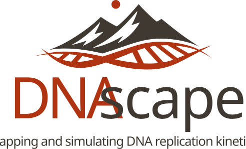

<p align="center">
  
</p>

# DNAscape

[](https://dnascape.readthedocs.io/en/latest/)

DNAscape is software for simulating and mapping DNA replication kinetics across genomic space and time. It connects origin initiation and replication fork dynamics to observable and inferred features of the replication programme, including replication timing, fork directionality, origin and fork density, origin efficiency, completion time, among others. It provides a mechanistic framework for moving between observed replication data, inferred kinetic features and simulated replication programmes, supporting analyses in which assumptions about origin firing, fork progression, genome geometry and replication stress can be stated clearly and tested quantitatively.

DNAscape v1.0.0 supports integration of replication datasets such as Repli-seq, SNS-seq, Ini-seq, and Fork-seq-style profiles, while remaining flexible enough to work with simulated tracks, custom genomic signals, and user-defined modelling assumptions. Full details and examples can be found in the [Documentation](https://dnascape.readthedocs.io/en/latest/).

## Core functionality

- **Simulate** DNA replication programmes in space and time from specified initiation and fork-speed assumptions.
- **Map** between replication features, including firing rate, replication timing, fork directionality, replicated fraction, and related outputs.
- **Fit or infer** one replication feature from another under fixed assumptions, rather than treating each assay as an isolated signal.
- **Test perturbations** such as altered initiation, reduced fork speed, fork stalling, dormant-origin activation, or changes in domain structure.
- **Validate pipelines** using synthetic replication programmes where the ground truth is known.
- **Visualise** replication tracks, distributions, heatmaps, and genomic feature context.

## Installation

DNAscape requires Python 3.9 or later. A clean virtual environment is recommended.

```bash
git clone https://github.com/fberkemeier/DNAscape.git
cd DNAscape

python -m venv .venv
source .venv/bin/activate   # Windows: .venv\Scripts\activate

python -m pip install --upgrade pip
python -m pip install -r requirements.txt
python -m pip install -e .
```

If you already manage Python environments another way, run the final two `pip install` commands inside your preferred environment.

## Quick start

For a guided first pass, we recommend starting with `examples/0_quickstart.ipynb`. The minimal Python workflow below shows the same basic logic in script form.

First import the core mapping and simulation functions.

```python
import numpy as np
from dnascape import (
    map_firing_timing,
    map_timing_firing,
    map_timing_directionality,
    rsim,
)
```

Define a simple synthetic initiation landscape.

```python
# Define a synthetic initiation landscape.
x = np.linspace(-3, 3, 500)
firing_rate = 0.02 + 0.08 * np.exp(-(x ** 2))
```

Map initiation activity to an expected replication-timing profile.

```python
# Forward mapping: initiation activity -> expected replication timing.
timing = map_firing_timing(
    firing_rate,
    fork_speed=1.4,
    resolution=1.0,
)
```

Map the timing profile to fork directionality.

```python
# Feature mapping: replication timing -> fork directionality.
fork_directionality = map_timing_directionality(
    timing,
    fork_speed=1.4,
    resolution=1.0,
)
```

Fit or infer initiation activity back from the timing profile under the same assumptions.

```python
# Inverse mapping: replication timing -> inferred initiation activity.
recovered_firing_rate = map_timing_firing(
    timing,
    fork_speed=1.4,
    resolution=1.0,
    maxiter=8,
    verbose=False,
)
```

Run a stochastic replication simulation from the initiation landscape.

```python
# Stochastic simulation under the same initiation assumptions.
sim = rsim(
    source={
        "firing_rate": firing_rate,
        "fork_speed": 1.4,
    },
    assumptions={
        "sim_number": 50,
        "resolution": 1.0,
        "seed": 1,
        "verbose": False,
    },
)

sim.keys()
```

Additional Jupyter notebooks in `examples/` show deterministic mappings, stochastic simulations, periodic-domain tests, fitting workflows, and biological case studies.

## Command-line interface

After installation, the `dnascape` command is available:

```bash
dnascape --help
```

The command-line interface auto-discovers public DNAscape functions and exposes them as subcommands. For example:

```bash
dnascape rsim --ori-rate frates.npy --fork-speed 1.4 --sim-number 100 --time-statsq
dnascape rfit --source firing_rate --target replication_timing --data frates.npy
```

For larger analyses, the Python API and notebooks are currently the recommended interface because they make assumptions, intermediate arrays, plots, and validation checks easier to inspect.

## Scientific scope

DNAscape is built around a general replication-kinetic description:

```text
initiation rate: I(x, t)
fork speed:      v(x, t)
```

where `x` is genomic position and `t` is replication time. Simple analyses can use fixed fork speed and position-dependent initiation. More general analyses can allow both initiation and fork speed to vary across space and time.

This supports two complementary modes of analysis:

- **Forward modelling** starts from a proposed mechanism and predicts the replication profiles it would generate.
- **Inverse mapping** starts from observed replication features and infers kinetic quantities that could explain them under fixed assumptions.

The purpose is not only to reproduce measured tracks, but to make the assumptions behind each interpretation explicit, testable, and comparable.

## Applications

- **Interpret replication data.**  
  Map between timing, initiation activity, fork directionality, replicated fraction, and simulated outputs using a shared kinetic framework.

- **Test mechanistic hypotheses.**  
  Ask whether altered initiation, fork-speed changes, fork stalling, dormant-origin activation, or other perturbations can explain an observed phenotype.

- **Compare biological conditions.**  
  Use the same assumptions and outputs to compare cell types, treatments, perturbations, or candidate therapeutic scenarios.

- **Benchmark analysis methods.**  
  Generate synthetic replication programmes, observe them through simulated outputs, and test whether fitting or downstream analysis recovers the known mechanism.

- **Integrate replication with genomic context.**  
  Combine replication features with genomic intervals, gene annotations, and region-based plots for biologically interpretable analysis.

## Workflow

A typical DNAscape analysis is an explicit loop between biological assumptions and observable replication features:

```text
biological question
    -> kinetic assumptions
    -> mapping or stochastic simulation
    -> predicted replication features
    -> comparison with data
    -> revised hypothesis
```

A validation workflow can start from a known mechanism and test whether the pipeline recovers it:

```text
known initiation rate and fork speed
    -> predicted timing and fork features
    -> stochastic replication ensembles
    -> fitted kinetic quantities from simulated observations
    -> comparison with the known input
```

## Citation

If you use DNAscape in your research, please cite the corresponding publication or software release.

## Questions, bugs, and feature requests

Please open an issue:

- https://github.com/fberkemeier/DNAscape/issues

For technical questions or collaboration requests, contact Francisco Berkemeier at fp409@cam.ac.uk.
