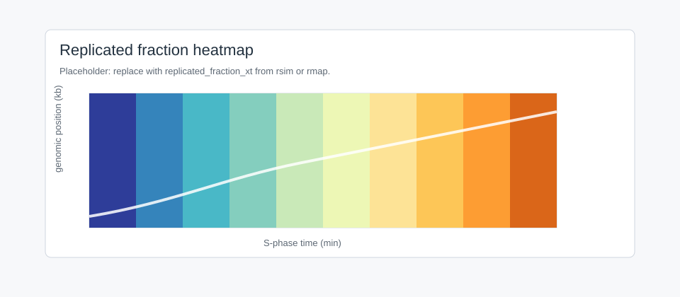

Data
====

Prepare data once, then reuse it in the package, app, and notebooks.

Forms
-----

.. list-table::
   :header-rows: 1
   :widths: 20 18 30 32

   * - Form
     - Shape
     - Use
     - Example
   * - ``space``
     - ``(n,)``
     - Genomic profile.
     - One chromosome column.
   * - ``time``
     - ``(1, T)``
     - S-phase time course.
     - Replicated fraction.
   * - ``spacetime``
     - ``(n, T)``
     - Position by time.
     - Heatmap or event density.
   * - ``table``
     - pandas table
     - Coordinates or labels must be kept.
     - ``chrom``, ``start_bp``, ``end_bp``, ``signal``.

Main helpers:

* ``rload``: load DNAscape-ready files.
* ``rsave``: save arrays or tables.
* ``rdata``: convert formats.
* ``rtrack``: bin BigWig or bedGraph tracks.

Files
-----

Supported plain formats: CSV, TSV, TXT, NPY, NPV, NPZ, and gzipped CSV/TSV/TXT.

Load one chromosome:

.. code-block:: python

   from dnascape import rload

   timing = rload(
       "data/replication_timing/replication_timing_H1.tsv",
       chromosome="chr1",
       data_form="space",
   )

Convert a table:

.. code-block:: python

   from dnascape import rdata

   rdata(
       "input/repliseq.csv",
       "prepared/repliseq_chr1.tsv",
       chromosome="chr1",
       data_form="space",
       decimal_places=4,
   )

Save arrays:

.. code-block:: python

   from dnascape import rsave

   rsave(firing_rate, "outputs/firing_rate_chr1.tsv", data_form="space")
   rsave(replicated_fraction, "outputs/replicated_fraction.tsv", data_form="time")

Tracks
------

Use ``rtrack`` for BigWig and bedGraph. Track coordinates are base pairs;
DNAscape axes are usually kb.

.. code-block:: python

   from dnascape import rtrack

   timing = rtrack(
       "tracks/repliseq_chr1.bw",
       chromosome="chr1",
       start=0,
       end=10_000_000,
       bin_size=10_000,
       aggregation="mean",
       data_form="space",
   )

bedGraph:

.. code-block:: python

   rfd = rtrack(
       "tracks/okseq_chr1.bedgraph",
       chromosome="chr1",
       bin_size=5_000,
       aggregation="mean",
       interpolation="linear",
       smooth_window=5,
       normalize="center",
       data_form="space",
   )

Multiple tracks become a matrix when their bins match:

.. code-block:: python

   heatmap = rtrack(
       ["early.bw", "mid.bw", "late.bw"],
       chromosome="chr2",
       start=20_000_000,
       end=30_000_000,
       bin_size=25_000,
       labels=["early", "mid", "late"],
       data_form="spacetime",
   )

   Placeholder for a space-time matrix.

Tables
------

Wide chromosome tables are supported:

.. code-block:: text

   bin   chr1    chr2    chr3
   0     42.1    38.7    51.2
   1     41.9    39.2    50.8

Use ``chromosome="chr1"`` or ``value_column="sample_a"`` to select one
column.

Resolution
----------

* Use the same ``resolution_x`` for profiles mapped together.
* Small bins keep local structure but cost more.
* Large bins reduce noise and runtime.
* For tracks, ``resolution_x = bin_size / 1000``.

Cleanup
-------

``rtrack`` supports:

* ``missing="nan"``, ``"zero"``, or ``"fill"``;
* ``interpolation="linear"``, ``"ffill"``, or ``"bfill"``;
* ``smooth_window`` for rolling mean smoothing;
* ``normalize="minmax"``, ``"zscore"``, ``"center"``, or ``"maxabs"``.

Use the lightest cleanup that makes the assay usable, and record it.
Zero and custom-value fills are applied after smoothing and normalization.
Missing bins retain their positions; dropping them is rejected. Text and CSV
loaders preserve empty rows, leading bins, and internal gaps. Only trailing
padding in wide chromosome tables is cropped when selecting a chromosome.
The Data Manager defaults to filling empty bins with zero and applies fills
after value scaling. Mapping reports remaining missing values by default.

App Page
--------

Data Management converts DNAscape-ready files and genomic tracks.

Inputs
   CSV, TSV, TXT, NPV, NPY, NPZ, gzipped plain files, BigWig, and bedGraph.

Controls
   Target format, gzip, data form, column, NPZ key, rounding, chromosome,
   interval, bin size, aggregation, missing values, smoothing, normalization.

Outputs
   Converted file, inferred shape, track preview, download, cached artifact.

Python
   Use ``rdata`` for conversion and ``rtrack`` for track binning.

Export
------

Use TSV/CSV for readable profiles, NPY/NPZ for exact numerical intermediates,
and TXT for simple vectors.

Checklist
---------

Before mapping or simulation:

* same chromosome, region, and resolution;
* coordinate units recorded;
* missing values handled;
* raw and prepared files separated;
* exported names include feature, chromosome, and resolution.
