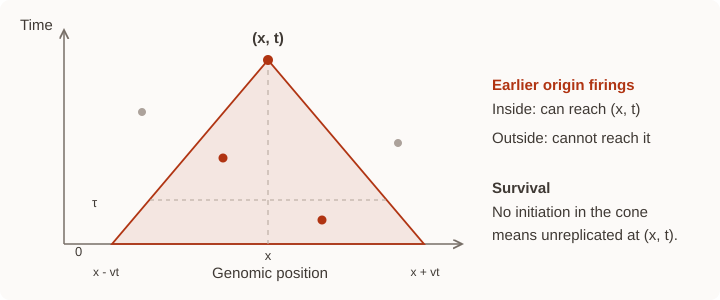

Core Concepts
=============

DNAscape connects measured genomic signals to a model of **origin firing**,
**fork movement** and **fork coalescence**. This chapter defines the quantities,
their units and the equations behind the main mappings. It also explains why
a good fit need not identify a unique replication programme.

.. _concept-grids:

Coordinates and dependence
--------------------------

A spatial profile contains one value per genomic bin. Regions use half-open
intervals: Start is included and End is excluded. For bin width
:math:`\Delta x`, a region of length :math:`L` needs approximately
:math:`L/\Delta x` values, with a partial final bin where necessary.

.. list-table:: Array conventions
   :header-rows: 1
   :widths: 22 22 56

   * - Dependence
     - Python shape
     - Meaning
   * - Constant
     - scalar
     - One value throughout the region and time domain.
   * - Space
     - ``(n,)``
     - One value per spatial bin.
   * - Time
     - ``(1, T)``
     - One value per time sample, shared across positions.
   * - Space-time
     - ``(n, T)``
     - Positions along rows, time samples along columns.

Genomic tracks use bp coordinates; Mapping and Simulation regions use kb.
Times are minutes. ``resolution_x`` denotes spatial bin width in kb, while
``resolution_t`` describes temporal input sampling. Recorded simulation
outputs use their returned ``time_grid``.

Changing resolution does not change the selected physical interval. For a
1 kb source, a 10 kb grid averages wider bins and has fewer values; a 0.1 kb
grid interpolates and has more values. Interpolation adds sampling locations,
not independent measurements. Plain profiles without coordinate metadata
need their source resolution to be supplied or interpreted explicitly.

.. _concept-units:

Initiation rate and fork speed
------------------------------

Let :math:`I(x,t)` be potential initiation rate per unit **unreplicated** DNA
length and time, with units :math:`\mathrm{kb}^{-1}\mathrm{min}^{-1}`. A high
rate favours origin firing, but an origin can be passively replicated before
it fires. Actual origin efficiency is therefore a different quantity.

Let :math:`v(x,t)>0` be fork speed in kb/min. Symmetric forks move in opposite
directions at the same local speed. The corresponding grid speed is
:math:`v/\Delta x` in bins/min; the app performs this conversion internally.

The initiation-rate convention at each interface matters:

.. math::

   I_{\mathrm{bin}}(x,t) = I(x,t)\,\Delta x.

* The direct Python ``rmap`` interface uses the density :math:`I`.
* ``rsim`` and the app's initiation-rate inputs use
  :math:`I_{\mathrm{bin}}`, in initiations per bin per minute.
* App-to-app mappings and transfers handle their own boundary conversions.
  When passing a Python ``rmap`` result to ``rsim``, multiply by
  ``resolution_x``; see :doc:`python`.

App region resampling averages or interpolates initiation-rate values under
its per-bin convention, rather than summing them. When constructing a grid
in Python to preserve a fixed physical density, recalculate
:math:`I_{\mathrm{bin}}` using the new bin width.

KJMA: nucleation, growth and coalescence
----------------------------------------

The Kolmogorov-Johnson-Mehl-Avrami (KJMA) framework describes transformation by
random nucleation followed by growth and merging. In one-dimensional DNA,
origin firing nucleates a replicated domain, two forks expand it, and
opposing forks coalesce when domains meet. Potential initiations in DNA that
has already replicated do not create new origins. The one-dimensional theory
and its replication interpretation are developed in [Jun2005I]_ and
[Jun2005II]_.

For independent Poisson initiation attempts and prescribed fork movement,
consider all earlier origin firings that could reach position :math:`x` by
time :math:`t`. This set is its **backward replication cone**
:math:`\mathcal C(x,t)`. The position remains unreplicated if that cone
contains no potential initiation:

.. math::

   S(x,t) = \exp[-A(x,t)], \qquad
   A(x,t) = \iint_{\mathcal C(x,t)} I(y,\tau)\,dy\,d\tau,
   \qquad f(x,t) = 1-S(x,t).

Here :math:`f` is the local probability of replication, equivalently the
replicated fraction across an ensemble of identical models. A constant-speed
cone is triangular; this construction also supports inhomogeneous initiation
[Baker2014]_.

   At constant speed, potential origin firings inside the shaded cone can
   reach the selected point. A finite region clips this cone; a periodic
   region wraps its spatial reach across the join.

Constant-speed example
~~~~~~~~~~~~~~~~~~~~~~

For constant speed :math:`v`, the points that can reach :math:`x` from time
:math:`\tau` lie between :math:`x-v(t-\tau)` and :math:`x+v(t-\tau)`.
On a sufficiently long homogeneous domain with constant initiation rate,
the cone integral becomes

.. math::

   A(t) = 2Iv\int_0^t (t-\tau)\,d\tau = Iv t^2,
   \qquad f(t)=1-\exp(-Iv t^2).

In this example the integrand uses constant :math:`I`; it is a rate multiplied
by the cone's growing spatial width. Boundaries, nonuniform inputs and
dependent initiation mechanisms require their appropriate model instead.

For a spatially uniform but time-dependent rate and speed, the same geometry
gives

.. math::

   R(t,\tau)=\int_\tau^t v(u)\,du, \qquad
   A(t)=2\int_0^t I(\tau)R(t,\tau)\,d\tau.

The distance travelled is the integral of speed over the intervening time,
not the final speed multiplied by elapsed time. When speed also depends on
position, fork paths satisfy :math:`dx/dt=\pm v(x,t)` and determine the
reachable region.

A time-dependent initiation model
~~~~~~~~~~~~~~~~~~~~~~~~~~~~~~~~~

Some fitting routes describe initiation with a Weibull-shaped hazard:

.. math::

   I(x,t)=
   \begin{cases}
      0, & t<d(x),\\
      k\,\alpha(x)[t-d(x)]^{k-1}, & t\ge d(x).
   \end{cases}

The amplitude :math:`\alpha`, delay :math:`d` and shape :math:`k` determine
the potential initiation programme. The shape :math:`k=1` gives a
memoryless constant hazard after the delay; larger shapes can produce an
increasing hazard. Amplitude units depend on :math:`k`:
:math:`\mathrm{kb}^{-1}\mathrm{min}^{-k}` in the density convention.

For uniform :math:`\alpha`, constant speed and zero delay, substituting into
the cone integral gives

.. math::

   A(t)=\frac{2v\alpha}{k+1}t^{k+1}.

Thus the hazard shape :math:`k` and the exponent of the replicated-fraction
curve are not the same parameter. This is a specified fitting family, not a
universal assumption about experimental origin firing.

Timing and directionality
-------------------------

If the replication time at :math:`x` is :math:`T_x` and replication completes
with probability one, its mean is the integral of survival:

.. math::

   \overline T(x)=\mathbb E[T_x]=\int_0^\infty [1-f(x,t)]\,dt.

A finite calculation must capture the surviving tail. An explicit clock
origin or delay must also match the observation's time reference.
For the constant-rate, constant-speed infinite-domain example,

.. math::

   \overline T=\frac{\sqrt{\pi}}{2\sqrt{Iv}}.

This relation identifies the product :math:`Iv`, demonstrating why timing
alone cannot in general distinguish initiation from fork movement.

Fork directionality is the probability of rightward replication minus the
probability of leftward replication. With a symmetric speed that is constant
in time, its connection to the timing gradient is

.. math::

   D(x)=v(x)\frac{d\overline T(x)}{dx}, \qquad -1\le D(x)\le1.

This identity underlies timing/directionality mappings. Numerical derivatives
are sensitive to noise and edge treatment. Inferring speed is ill-conditioned
where timing is nearly flat; bounds and regularisation remain important.
A periodic derivative uses neighbours across the join rather than a forced
endpoint value.

.. _concept-events:

Fork transport and actual event densities
-----------------------------------------

Let :math:`\rho_+` and :math:`\rho_-` be right- and left-moving fork densities
per kb. In the symmetric mean-field model, replication progresses according
to [Gauthier2012]_

.. math::

   \partial_t f=v(\rho_++\rho_-).

Initiation creates one fork of each direction; coalescence removes one of
each. The corresponding transport equations are

.. math::

   \partial_t\rho_+ + \partial_x(v\rho_+) = j_i-j_c,
   \qquad
   \partial_t\rho_- - \partial_x(v\rho_-) = j_i-j_c,

with event-rate densities

.. math::

   j_i=I(1-f), \qquad
   j_c=\frac{2v\rho_+\rho_-}{1-f}.

The coalescence expression uses the mean-field closure for opposing forks;
it is not an assumption that arbitrary correlated stall or resource-limited
models obey the same equations. Numerically, the fully replicated limit
needs stable handling as :math:`1-f` approaches zero.

Both :math:`j_i` and :math:`j_c` have units **events/(kb min)**. Their time
integrals are **events/kb**; they are not normalised probability densities.
Total fork count is :math:`\int(\rho_++\rho_-)dx`.

In a completely replicated ensemble, directional probabilities weight fork
densities by the local speed:

.. math::

   P_\pm(x)=\int_0^\infty v(x,t)\rho_\pm(x,t)\,dt,
   \qquad D(x)=P_+(x)-P_-(x).

An unweighted ratio of integrated directional densities is not generally
appropriate when speed varies over time.

Simulation outputs count realised events in discrete spatial and temporal
bins, averaged across replicates. For comparison with a continuous rate
density, account for both bin width and recording interval. For example,
actual origin firing in a time interval is the integral of :math:`j_i` over
that interval and over the simulated region. A small spatial bin's origin
efficiency is approximately :math:`\Delta x\int j_i(x,t)dt`.

Fitting, masks and model interpretation
---------------------------------------

A timing fit commonly minimises mean squared error on valid scored positions
:math:`\mathcal V`:

.. math::

   \operatorname{MSE}(\theta)=
   \frac{1}{|\mathcal V|}\sum_{x_j\in\mathcal V}
   [T_{\mathrm{model}}(x_j;\theta)-T_{\mathrm{observed}}(x_j)]^2.

The fitted parameters :math:`\theta` depend on the target family, supplied
inputs, bounds and region constraints. A numerical lower floor keeps a fitted
rate stable; it is distinct from an MSE stopping threshold. More iterations
optimise the chosen model and do not add experimental information.

A **mask** specifies which positions receive a regional operation. In
Mapping, transformed initial target values are held fixed there while other
values are fitted. In Data Manager and Simulation, the transform edits prepared
values or model inputs. In Analysis, a mask can restrict statistics without
compacting or shifting genomic indices.

Linear boundaries can omit origins outside the selected region. Periodic
models have a wrapped join but can still be sensitive to their assumed period.
Use matching coordinates and compare model predictions, residuals and
independent measurements. General :math:`I(x,t)` and :math:`v(x,t)` cannot
both be identified uniquely from one mean timing profile.

``rmap`` provides deterministic relationships and fitted predictions under
its route assumptions. ``rsim`` samples stochastic realisations, including
supported stalling and finite-factor mechanisms. Ensemble variation, finite
replicate counts and model mismatch can all contribute to differences between
a map and a simulated or measured profile.

Further reading
---------------

.. [Jun2005I] S. Jun, H. Zhang and J. Bechhoefer (2005).
   *Nucleation and growth in one dimension, part I: The generalized
   Kolmogorov-Johnson-Mehl-Avrami model.* Physical Review E 71, 011908.
   `Paper <https://doi.org/10.1103/PhysRevE.71.011908>`_.

.. [Jun2005II] S. Jun and J. Bechhoefer (2005).
   *Nucleation and growth in one dimension, part II: Application to DNA
   replication kinetics.* Physical Review E 71, 011909.
   `Paper <https://doi.org/10.1103/PhysRevE.71.011909>`_.

.. [Baker2014] A. Baker and J. Bechhoefer (2014).
   *Inferring the spatiotemporal DNA replication program from noisy data.*
   Physical Review E 89, 032703.
   `Paper <https://doi.org/10.1103/PhysRevE.89.032703>`_.

.. [Gauthier2012] M. G. Gauthier, P. Norio and J. Bechhoefer (2012).
   *Modeling Inhomogeneous DNA Replication Kinetics.* PLOS ONE 7, e32053.
   `Paper <https://doi.org/10.1371/journal.pone.0032053>`_.
