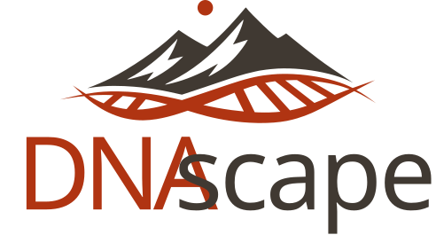

.. title:: DNAscape

.. toctree::
   :maxdepth: 1
   :caption: Contents

   gettingstarted
   appguide
   python
   foundations
   releasenotes

Overview
========

DNAscape is software for mapping and simulating DNA replication through two
complementary workflows. Its *mapping workflow* infers origin firing and fork
speed from replication timing, origin competence, fork directionality and
other features. Its *simulation workflow* models individual S phases and
whole-genome replication programmes, quantifying inter-origin distances,
origin efficiency, S-phase duration and other replication statistics. Tools
for preparing data, visualising results, analysing datasets and applying
regional perturbations support both workflows, including profiles derived
from Repli-seq, SNS-seq and OK-seq. Use DNAscape through its browser app,
Python scripts, Jupyter notebooks or the command line to investigate
replication stress, variability between cells and the mechanisms shaping
replication across organisms and cell types.

Citation
========

If you use DNAscape in research, please cite the software using the metadata in
`CITATION.cff <https://github.com/fberkemeier/DNAscape/blob/main/CITATION.cff>`_.
On GitHub, select **Cite this repository** to copy the citation in APA or
BibTeX format. Include the software version and model settings used.

Once available, please also cite the accompanying preprint:

   Francisco Berkemeier and Michael A. Boemo (2026).
   *DNAscape: Software for mapping and simulating DNA replication kinetics.*
   bioRxiv.

Bugs, questions and comments
============================

DNAscape is under active development by Francisco Berkemeier. For bug reports,
questions, comments or feature requests, raise an issue on
`GitHub Issues <https://github.com/fberkemeier/DNAscape/issues>`_ or contact
`Francisco Berkemeier <mailto:fp409@cam.ac.uk>`_. DNAscape is available under
the `MIT License <https://github.com/fberkemeier/DNAscape/blob/main/LICENSE>`_.
