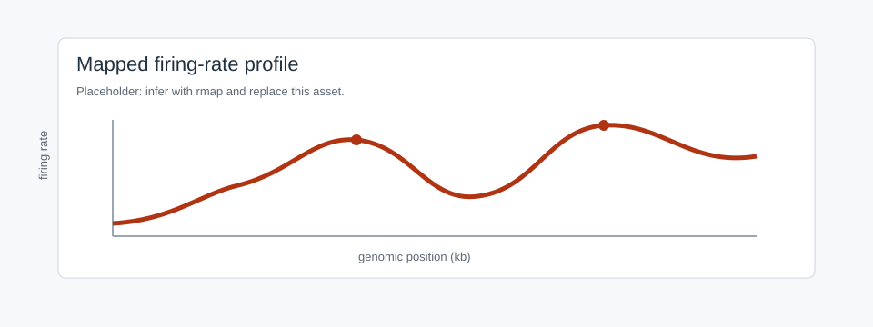
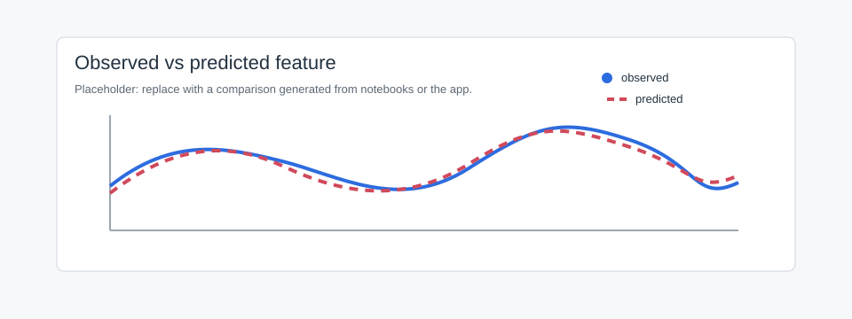
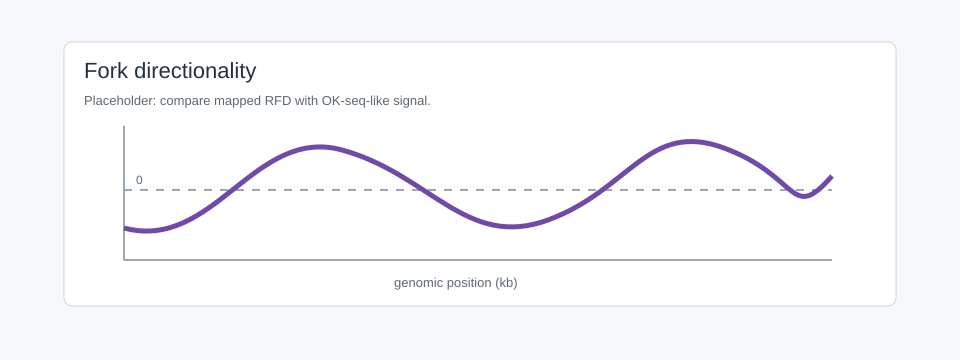

Mapping with rmap
=================

``rmap`` maps between replication features under stated assumptions.

Call
----

.. code-block:: python

   from dnascape import rmap

   initiation_rate = rmap(
       source={"replication_timing": timing, "fork_speed": 1.4},
       target="initiation_rate",
       assumptions={"resolution_x": 1.0, "target_form": "space"},
   )

Single-source form:

.. code-block:: python

   timing_pred = rmap(
       source="initiation_rate",
       data=initiation_rate,
       target="replication_timing",
       assumptions={
           "fork_speed": 1.4,
           "resolution_x": 1.0,
           "sim_number": 100,
           "seed": 1,
           "verbose": False,
       },
   )

Routes
------

Inspect the installed route table:

.. code-block:: python

   rmap.targets()
   rmap.requirements(target="initiation_rate")
   rmap.requirements(target="fork_speed", detail=True)

Common targets:

* ``initiation_rate``
* ``fork_speed``
* ``replication_timing``
* ``fork_directionality``
* ``replicated_fraction`` / ``replicated_fraction_xt``
* ``fork_densities_xt``
* ``initiation_events`` / ``initiation_events_xt``
* ``coalescence_events`` / ``coalescence_events_xt``
* ``origin_efficiency``
* ``inter_origin_distance``
* ``completion_time``
* ``num_origins``

Timing To Initiation Rate
-------------------------

.. code-block:: python

   initiation_rate = rmap(
       source={"replication_timing": timing, "fork_speed": 1.4},
       target="initiation_rate",
       assumptions={
           "resolution_x": 1.0,
           "resolution_t": 2.0,
           "target_form": "space",
           "target_shape": "weibull",
           "maxiter": 20,
           "fit_step": 0.6,
       },
   )

``target_form`` selects constant, space, time, or space-time output.
``target_shape`` controls parametric time dependence where relevant.

   Placeholder for mapped initiation rate.

Initiation Rate To Timing
-------------------------

.. code-block:: python

   timing_pred = rmap(
       source={"initiation_rate": initiation_rate, "fork_speed": 1.4},
       target="replication_timing",
       assumptions={
           "resolution_x": 1.0,
           "sim_number": 200,
           "seed": 11,
           "verbose": False,
       },
   )

Compare:

.. code-block:: python

   import numpy as np

   mse = np.nanmean((timing - timing_pred) ** 2)

   Placeholder for observed and predicted timing.

Timing To Speed
---------------

.. code-block:: python

   fork_speed_x = rmap(
       source={"replication_timing": timing, "initiation_rate": initiation_rate},
       target="fork_speed",
       assumptions={
           "resolution_x": 1.0,
           "target_form": "space",
           "initial_fork_speed": 1.4,
           "speed_bounds": (0.2, 4.0),
           "maxiter": 20,
       },
   )

Timing To RFD
-------------

.. code-block:: python

   rfd = rmap(
       source={"replication_timing": timing, "fork_speed": 1.4},
       target="fork_directionality",
       assumptions={"resolution_x": 1.0, "smoothw": 25},
   )

   Placeholder for fork directionality.

Space-Time Features
-------------------

.. code-block:: python

   import numpy as np

   time_grid = np.arange(0, 240 + 2, 2)

   fraction_xt = rmap(
       source={"initiation_rate": initiation_rate, "fork_speed": 1.4},
       target="replicated_fraction_xt",
       assumptions={
           "resolution_x": 1.0,
           "resolution_t": 2.0,
           "time_grid": time_grid,
       },
   )

   fork_densities = rmap(
       source={"initiation_rate": initiation_rate, "fork_speed": 1.4},
       target="fork_densities_xt",
       assumptions={
           "resolution_x": 1.0,
           "resolution_t": 2.0,
           "time_grid": time_grid,
       },
   )

App Page
--------

Mapping exposes focused ``rmap`` routes.

Inputs
   Numeric timing, initiation-rate, fork-speed, or directionality tables; optional
   constants.

Controls
   Target, dependence, route, chromosome, region, resolution, fit settings,
   geometry, plot settings.

Outputs
   Preview, figure exports, raw mapped data, cached artifact.

Python
   ``rmap(source=..., target=..., assumptions=...)``.

Notes
-----

* Use ``return_info=True`` to save route metadata.
* Keep ``resolution_x`` consistent.
* Increase ``sim_number`` for stable simulation-backed routes.
* Start simple, then fit more variable kinetic fields.
* Export outputs and assumptions together.
