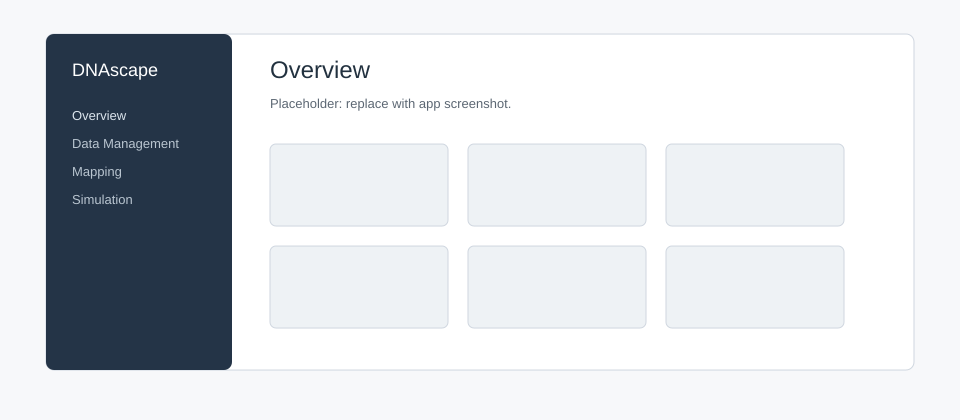

NiceGUI App
===========

Run the local interface from the repository root:

.. code-block:: bash

   python -m pip install -r app/requirements.txt
   python -m app

Open ``http://127.0.0.1:8080`` after the server starts. DNAscape does not
launch a browser automatically; set ``DNASCAPE_APP_SHOW=true`` to opt in.
Use the app for inspection and short interactive runs; use Python scripts or
notebooks for reproducible analyses, sweeps, and publication pipelines.

Pages
-----

Overview
   Navigate between Data Manager, Mapping, Simulation, Plotting, Cached Files,
   and Resources.

Data Manager
   Add a local file or a bounded public HTTP(S) link. The app automatically
   detects CSV, TSV, TXT, NPY, NPV, NPZ, bedGraph, and BigWig formats, while the
   biological role remains an explicit user choice. For genomic tracks, choose
   one chromosome and an optional half-open interval, or prepare every
   chromosome, then configure binning, aggregation, missing bins, interpolation,
   centred smoothing, threshold masking, and one mutually exclusive value-scaling
   operation: multiplier, target interval (including optional inversion), centre,
   Z-score, or maximum absolute. A target interval is defined explicitly by its
   target minimum and target maximum. Thresholds are evaluated before smoothing
   and value scaling.
   Empty bins default to Fill with zero, including for the ENCODE example.
   Thresholded samples remain on the original coordinate grid. Zero and custom
   fills are applied after smoothing and value scaling; Keep empty bins preserves
   missing values. Fill with minimum and Fill with maximum instead use each
   chromosome's finite values after thresholding and smoothing, fill empty bins
   before scaling, and participate in the scaling calculation. They report an
   error if no finite values remain. Mapping reports remaining missing values by
   default and
   never drops leading or internal bins. Dropping missing bins is unsupported.
   The same polishing operations are available for selected space, time, and
   space-time profiles. Generated files contain regularly spaced DNAscape profile
   values, not source
   coordinate columns. A one-chromosome text export uses that chromosome as its
   header; an all-chromosome text export is a wide table with chromosome
   headers, while NPZ keeps one native-length array under each chromosome key.
   Formats that cannot retain chromosome identity are not offered for an
   all-chromosome export. TSV is the default. A shared-style plot preview can be
   enabled in Export settings and is off by default and limited to 500 displayed
   points. Generated files remain available in Cached Files for the browser tab.

   A curated UCSC ENCODE DCC K562 Repli-seq BigWig link is available as a test
   source. Its wavelet signal is a relative timing score (larger values are
   earlier), not an absolute replication time in minutes; the Data Manager does
   not silently change that scientific meaning.

   The K562 SNS-seq BED example selects column 4 (average enrichment ratio),
   excluding IGV display scores and coordinates. Prepare as Firing rate uses
   1 kb bins, maximum aggregation to retain peak heights, zero background,
   no interpolation, and no smoothing. Its enrichment values represent relative
   origin activity; a firing-rate calibration remains an explicit scaling choice.
   Scored BED peaks offer maximum, mean, integrated signal, and coverage;
   BED3 calls offer presence, covered bases, and coverage. Continuous bedGraph
   and BigWig retain their supported signal aggregations. Interpolation is
   unavailable between called peaks, and firing-rate scaling excludes centre
   and Z-score. BED peak previews retain local extrema at their original
   coordinates within the 500-point limit. Repli-seq BigWig conversion and
   preview behavior are unchanged.

Mapping
   Configure ``rmap`` inputs, regions, routes, and preview settings, then run
   the resolved route in a cancellable background worker.

   Enable **Dev Mode** in Settings and use **Code** to download the current
   Mapping configuration as Python or a runnable ZIP. The ZIP includes original
   inputs, the current DNAscape package source and dependency requirements.
   Extract it, install ``requirements.txt``, and run ``python mapping.py`` with
   Python 3.10 or newer; alternatively use ``uv run mapping.py``.
   Edit ``MAPPING`` for inputs and scientific settings and ``RAW_EXPORT`` for
   output selection, filenames, formats, compression and individual batch
   choices. Plotting is optional: set ``PLOT = True`` and edit ``PLOTTING`` to
   generate the same ECharts views as standalone HTML with PNG/SVG downloads.
   Exporting code does not start Mapping or replace its results.

Simulation
   Run bounded constant or uploaded firing-rate and fork-speed fields through ``rsim``.
   Progress appears in Preview while the scientific worker runs. Completion
   times, origins per replicate, and pooled inter-origin distances are standard
   ensemble outputs and do not require temporal tracking. Enable **Track time
   courses** for one-dimensional time summaries, and enable **Track space-time
   outputs** only for the five position-by-time matrices. The app validates
   actual retained-array sizes before allocation. Inter-origin distances use
   ``rsim`` values in kb, appear as a histogram by default, and can be switched
   to a box plot without rerunning the simulation. Very large IOD pools retain a
   deterministic bounded prefix and report that truncation explicitly.

   Every run calculates the population standard deviation of replication timing
   across the full ensemble. In the default replication-timing line view,
   **Plotting settings** can show it as a filled mean ± standard-deviation band.
   A memory-bounded subset of at most 50 replication-timing profiles is retained
   independently of temporal or space-time tracking, from which the user can
   overlay individual simulations. Changing either display does not rerun the
   simulation.

   Plot previews can be enlarged and exported as PNG, SVG, or PDF. Selected
   raw arrays can be downloaded as CSV, TSV, TXT, NPY, or NPZ. The application
   Settings menu controls plot DPI and raw compression; GZIP is the default.
   Conversion memory limit (MB) sets the estimated working-memory budget for
   BigWig and bedGraph preparation, from 64 MB (default) to 4096 MB. Choosing
   512 MB allows the K562 example at 1 kb bins for all chromosomes (about
   322 MB estimated). Related track array and download limits scale with the
   budget. It does not reserve RAM, cap actual process RAM use, or change upload
   limits. Settings changes take effect immediately. Application restart and
   Reset everything restore the 64 MB default.
   Histogram views expose synchronized bin-count, exact bin-size, and editable
   X-range controls. Changing the range preserves the requested bin width and
   updates the count, while the reset action restores the full data range. Bars
   can touch or use a small visual gap, and the boundary selector determines
   whether values exactly on an internal edge are counted in ``[a, b)`` or
   ``(a, b]``; both outer range endpoints remain included. Histograms display
   the mean, median, and population standard deviation by default in a compact
   summary box positioned in any plot corner.

Plotting
   Upload one or more profiles and create profile, heatmap, histogram, or
   box-plot previews with the same plotting controls used by Mapping and
   Simulation.

Cached Files
   Search, sort, download, reopen, or remove uploads, prepared datasets,
   generated files, and completed workflows retained in the current browser
   tab. The oldest entries are removed automatically above 30 items per
   category, 80 items overall, or 256 MB retained memory. The cache is cleared
   when the app process ends.

Resources
   Open the repository, documentation, issue tracker, and citation guidance.

   DNAscape application layout.

Constant Simulation Example
---------------------------

1. Open **Simulation**.
2. Keep both inputs set to **Constant**.
3. Choose the genomic interval, resolution, replicate count, and seed.
4. Leave both optional trackers off for the quickest summary preview. Enable
   **Track time courses** for replicated fraction and fork-count curves; enable
   **Track space-time outputs** for initiation/coalescence and fork-density
   heatmaps. Inter-origin-distance histograms and box plots are always available.
5. Select **Simulate** and monitor progress in Preview.
6. Choose the output to display, then use the hover toolbar or Raw data section
   to export it.

Safety Limits
-------------

The local interface accepts up to 50,000 simulations per ensemble in both
Simulation and Mapping. It validates numeric inputs and genuine retained-array,
spatial-grid, temporal-grid, upload, and browser-payload limits before calling
``rsim``. It does not reject an otherwise valid run merely because the number
of bins multiplied by the number of simulations is large. Oversized retained
outputs are rejected with guidance to coarsen the resolution or shorten the
requested window.
