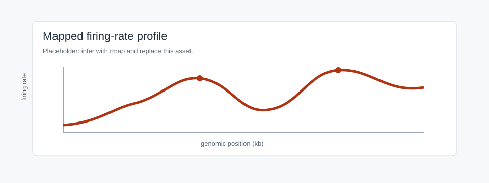

Quickstart
==========

This example builds a timing profile, maps it to initiation rate with ``rmap``,
simulates with ``rsim``, and exports the results.

Python
------

.. code-block:: python

   import numpy as np
   from dnascape import rmap, rsim, rsave

   x_kb = np.arange(0, 500, 1.0)
   replication_timing = 35 + 25 * (1 - np.exp(-((x_kb - 250) / 130) ** 2))
   fork_speed = 1.4  # kb/min

Map timing to initiation rate:

.. code-block:: python

   initiation_rate = rmap(
       source={
           "replication_timing": replication_timing,
           "fork_speed": fork_speed,
       },
       target="initiation_rate",
       assumptions={
           "resolution_x": 1.0,
           "target_form": "space",
           "target_shape": "weibull",
           "maxiter": 10,
       },
   )

Simulate:

.. code-block:: python

   simulation = rsim(
       source={"initiation_rate": initiation_rate, "fork_speed": fork_speed},
       assumptions={
           "sim_number": 100,
           "resolution_x": 1.0,
           "resolution_t": 2.0,
           "time_statsQ": True,
           "seed": 7,
           "verbose": False,
       },
   )

   predicted_timing = simulation["replication_timing"]
   replicated_fraction = simulation["replicated_fraction"]

Export:

.. code-block:: python

   rsave(initiation_rate, "outputs/initiation_rate_chr1.tsv", data_form="space")
   rsave(predicted_timing, "outputs/predicted_timing_chr1.tsv", data_form="space")
   rsave(replicated_fraction, "outputs/replicated_fraction.tsv", data_form="time")

   Placeholder for an inferred initiation-rate profile.

Same Workflow In The App
------------------------

.. list-table::
   :header-rows: 1
   :widths: 24 38 38

   * - Step
     - App
     - Python
   * - Prepare input
     - Data Management: convert or bin input files.
     - ``rload``, ``rdata``, ``rtrack``.
   * - Map
     - Mapping: target **Initiation rate**, route **Replication timing + fork
       speed**.
     - ``rmap(..., target="initiation_rate")``.
   * - Simulate
     - Simulation: supply initiation rate, fork speed, replicates, seed.
     - ``rsim(source=..., assumptions=...)``.
   * - Export
     - Use page export controls or Cached Files.
     - ``rsave`` or matplotlib ``savefig``.

Bundled Data
------------

.. code-block:: python

   from dnascape import loadcsv, select_profile_region, plotf

   timing_full = loadcsv("replication_timing", cell_line="H1", chr_number=1)
   timing, x_kb = select_profile_region(
       timing_full,
       raw_resolution_kb=1.0,
       interval_kb=(10_000, 40_000),
   )

   plotf(
       timing,
       x_array=x_kb,
       xtitle="Genomic position (kb)",
       ytitle="Replication timing (min)",
       invyQ=True,
   )

Notebook version: ``examples/0-quickstart.ipynb``.

Outputs
-------

``rmap`` returns the requested feature. With ``return_info=True`` it returns
values plus route metadata.

``rsim`` always returns timing, origin efficiency, fork directionality,
completion time, origin counts, and inter-origin distances. Time courses need
``time_statsQ=True``. Space-time fields need ``time_stats_xtQ=True``.

Next
----

* :doc:`foundations`: terms and shapes.
* :doc:`datamanagement`: input preparation.
* :doc:`mappingfunctions`: ``rmap`` routes.
* :doc:`simulationengine`: ``rsim`` controls.
