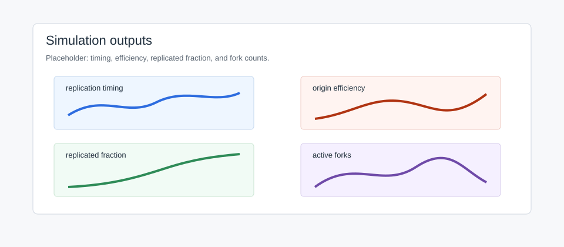
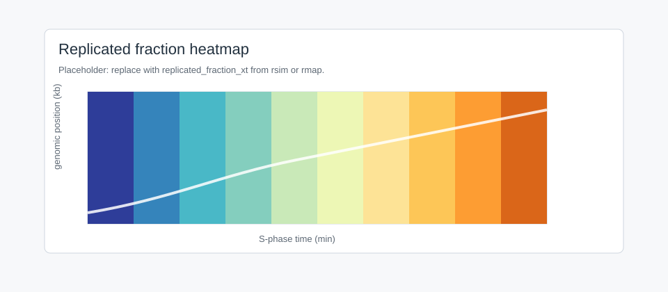

Simulation with rsim
====================

``rsim`` simulates stochastic S phases from initiation rate and fork speed.

Call
----

.. code-block:: python

   import numpy as np
   from dnascape import rsim

   simulation = rsim(
       source={"initiation_rate": initiation_rate, "fork_speed": 1.4},
       assumptions={
           "sim_number": 100,
           "resolution_x": 1.0,
           "resolution_t": 2.0,
           "time_grid": np.arange(0, 300 + 2, 2),
           "time_statsQ": True,
           "seed": 42,
           "verbose": False,
       },
   )

Inputs
------

``initiation_rate`` and ``fork_speed`` can be:

* scalar;
* spatial ``(n,)``;
* time-only ``(1, T)``;
* space-time ``(n, T)``.

If both inputs lack a spatial axis, pass ``n_bins``, ``genome_length``, or
``interval_kb``.

Fork movement
-------------

Fork speeds follow the supplied field by default. Set ``fork_speed_std`` to a
non-negative arithmetic standard deviation in kb/min to draw positive lognormal
speeds with the local input value as their arithmetic mean, independently for
each spatial bin, direction, and replicate. Time-dependent fields use draws
per encountered time slice and integrate distance through clock boundaries
while crossing a bin. Draws are reused when propagation revisits a cell.
This avoids the divergent mean crossing time caused by normally distributed
speeds conditioned on being positive, without imposing a speed floor. With
zero deviation the original simulation and seeded results are unchanged.

For example, ``assumptions={"fork_speed_std": 0.2, "seed": 42}`` adds speed
variation to any supported fork-speed dependence. Stalling and finite
firing-factor pools can be enabled independently.

Outputs
-------

Always returned:

* ``replication_timing``
* ``replication_timing_std``
* ``completion_time`` (absolute simulation-clock completion timestamp)
* ``s_phase_duration`` (completion minus the first realised initiation)
* ``num_origins`` / ``num_oris``
* ``origin_efficiency`` / ``efficiency``
* ``fork_directionality``
* ``inter_origin_distance_count``
* ``inter_origin_distances_truncated``

Per-simulation replication-time profiles and pooled inter-origin distances are
retention outputs, not space-time statistics. ``retain_rep_times_per_sim`` and
``retain_inter_origin_distances`` control them independently. Use
``retain_rep_times_limit`` or ``retain_inter_origin_distances_limit`` to keep a
deterministic prefix without changing any ensemble summaries. For a bounded
inter-origin distribution, ``inter_origin_distance_count`` reports the complete
number of distances produced and ``inter_origin_distances_truncated`` reports
whether the retained array is incomplete. Disabling distance retention avoids
constructing those per-realization arrays while still reporting their total
count.

With ``time_statsQ=True``:

* ``time_grid``
* ``replicated_fraction``
* ``total_forks``
* ``active_forks``
* ``stalled_forks``
* ``origin_firing``: mean actual initiations per sampling interval ending at
  each time-grid point, excluding passively replicated firing proposals.
* ``replicon_lengths``: pooled completed DNA-domain lengths per fired origin
  in kb. Periodic domains are joined across the seam; unfinished domains are
  excluded. ``retain_replicon_lengths_limit`` bounds retained samples, while
  ``replicon_length_count`` and ``replicon_lengths_truncated`` report the full
  count and any truncation.
* ``firing_factors`` when finite factors are enabled.

With ``time_stats_xtQ=True`` (the memory-intensive, detailed outputs):

* ``time_grid`` and ``replicated_fraction``
* ``replicated_fraction_xt``
* ``initiation_events_xt``
* ``coalescence_events_xt``
* ``right_fork_density_xt``
* ``left_fork_density_xt``
* ``fork_density_xt``: the sum of the right- and left-moving densities.

Initiation-event fields record only origins that fired before passive
replication, within the requested time grid and simulation stopping time.

   Placeholder for simulation outputs.

Perturbations
-------------

Fork slowing:

.. code-block:: python

   slow_fork = rsim(
       source={"initiation_rate": initiation_rate, "fork_speed": 0.8},
       assumptions={"sim_number": 200, "resolution_x": 1.0, "seed": 3, "verbose": False},
   )

Fork stalling:

.. code-block:: python

   stalled = rsim(
       source={"initiation_rate": initiation_rate, "fork_speed": 1.4},
       assumptions={
           "sim_number": 200,
           "resolution_x": 1.0,
           "stall_rate_per_kb": 0.02,
           "tau": 15.0,
           "seed": 4,
           "verbose": False,
       },
   )

``stall_rate_per_kb`` is a physical encounter density in stalls/kb. DNAscape
converts it at the selected spatial resolution using
``p_bin = 1 - exp(-stall_rate_per_kb * resolution_x)``. The older
``stall_rate`` keyword remains available as a probability per spatial bin for
backward compatibility.
By default, directions have independent stall positions and recovery delays.
Set ``stall_shared_directions=True`` to use the same positions and delays for
forks arriving from either direction. This represents shared genomic barriers;
it does not pause a distant sister fork when its partner stalls.

Finite factors:

.. code-block:: python

   finite_factors = rsim(
       source={"initiation_rate": initiation_rate, "fork_speed": 1.4},
       assumptions={
           "sim_number": 200,
           "ffiring_nr": 60,
           "ffiring_recycle": 0.05,
           "time_statsQ": True,
           "seed": 5,
           "verbose": False,
       },
   )

Space-Time
----------

Space-time fields scale with bins times time points. Request them only when
needed.

.. code-block:: python

   heatmap_sim = rsim(
       source={"initiation_rate": initiation_rate, "fork_speed": 1.4},
       assumptions={
           "sim_number": 50,
           "resolution_x": 1.0,
           "resolution_t": 2.0,
           "time_grid": np.arange(0, 300 + 2, 2),
           "time_statsQ": True,
           "time_stats_xtQ": True,
           "seed": 8,
           "verbose": False,
       },
   )

   Placeholder for a replicated-fraction heatmap.

Compare
-------

.. code-block:: python

   import numpy as np

   predicted = simulation["replication_timing"]
   valid = np.isfinite(timing) & np.isfinite(predicted)
   timing_mse = np.mean((timing[valid] - predicted[valid]) ** 2)

Export:

.. code-block:: python

   from dnascape import rsave

   rsave(predicted, "outputs/simulated_timing.tsv", data_form="space")
   rsave(simulation["origin_efficiency"], "outputs/origin_efficiency.tsv", data_form="space")

App Page
--------

Simulation runs ``rsim`` interactively.

Inputs
   Initiation rate and fork speed as constants or uploaded profiles.

Controls
   Region, resolution, replicates, geometry, time window, stalling, finite
   factors, seed, output, plot view.

Outputs
   Timing, efficiency, directionality, replicated fraction, fork counts,
   factors, and space-time fields.

Python
   ``rsim(source=..., assumptions=...)``.

Performance
-----------

* Use small ``sim_number`` while exploring.
* Avoid ``time_stats_xtQ=True`` unless needed.
* Coarser ``resolution_x`` and ``resolution_t`` reduce cost.
* Use ``dens_memmap_dir`` for large space-time outputs.
* Set ``seed`` for comparisons.
