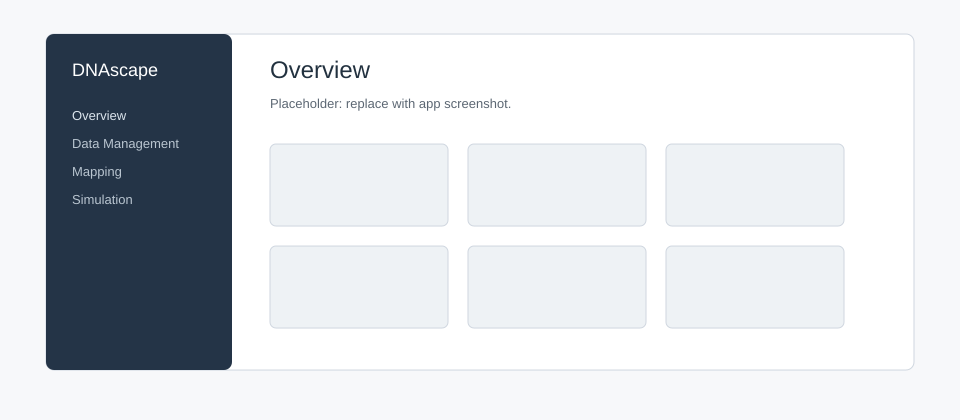
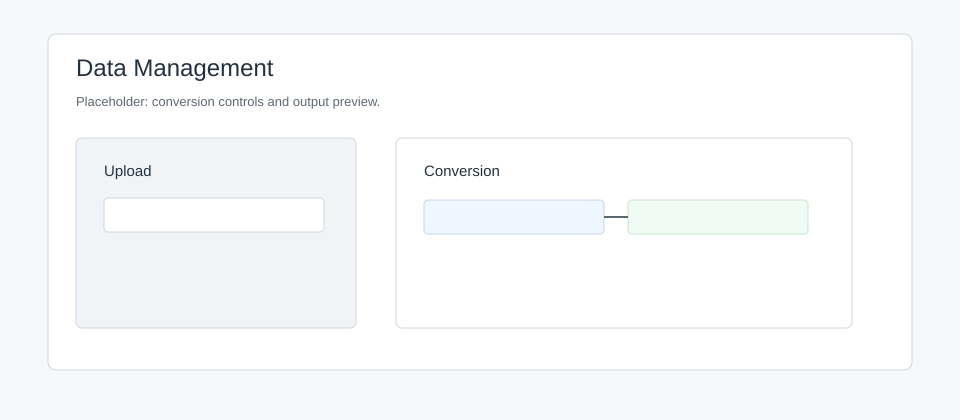
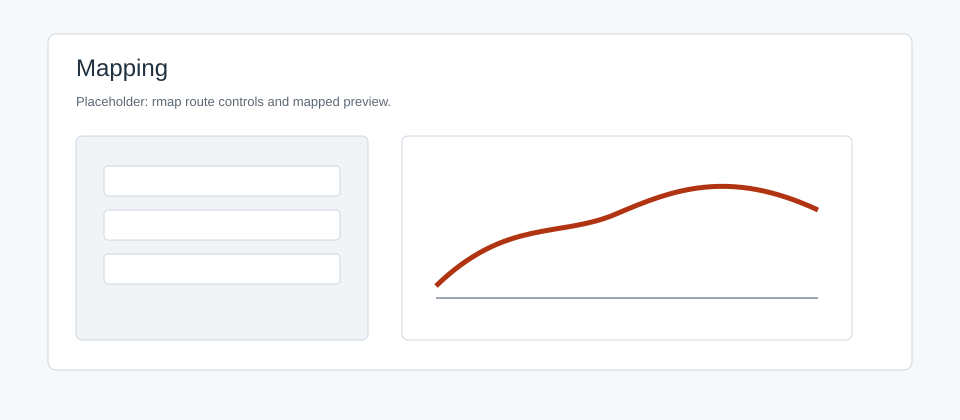
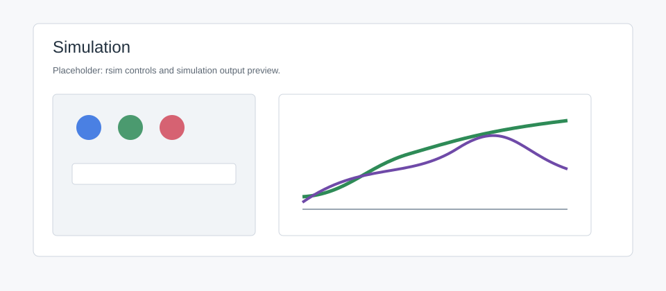

Streamlit App
=============

Run from the repository root:

.. code-block:: bash

   streamlit run app_streamlit/streamlit_app.py

Use the app for inspection, short mapping runs, simulation previews, and
exports. Use Python for final reproducible analysis.

Overview
--------

Links to Data Management, Mapping, Simulation, Plotting, Cached Files, and
Resources.

   Placeholder for the Overview page.

Data Management
---------------

Purpose
   Convert DNAscape-ready files and bin genomic tracks.

Inputs
   CSV, TSV, TXT, NPV, NPY, NPZ, gzipped files, BigWig, bedGraph. BigWig needs
   ``pyBigWig``.

Outputs
   Converted file, inferred form, shape, coordinate preview, cached artifact.

Python
   ``rdata`` and ``rtrack``.

.. code-block:: python

   from dnascape import rdata, rtrack

   rdata("input.csv", "output.tsv", chromosome="chr1", data_form="space")
   timing = rtrack("timing.bw", chromosome="chr1", bin_size=10_000)

   Placeholder for Data Management.

Mapping
-------

Purpose
   Run selected ``rmap`` routes and preview outputs.

Inputs
   Timing, firing-rate, fork-speed, or directionality tables; optional
   constants.

Controls
   Target, dependence, route, chromosome, region, resolution, fit settings,
   geometry, plot settings.

Outputs
   Mapped preview, figure exports, raw output, cached artifact.

Python
   ``rmap(source=..., target=..., assumptions=...)``.

.. code-block:: python

   firing_rate = rmap(
       source={"replication_timing": timing, "fork_speed": 1.4},
       target="firing_rate",
       assumptions={"resolution_x": 1.0, "target_form": "space"},
   )

   Placeholder for Mapping.

Simulation
----------

Purpose
   Run ``rsim`` and preview simulated features.

Inputs
   Firing rate and fork speed as constants or profiles.

Controls
   Region, resolution, replicates, geometry, time window, stalls, finite
   factors, seed, output, plot style.

Outputs
   Timing, efficiency, directionality, replicated fraction, fork counts,
   factors, and space-time fields.

Python
   ``rsim(source=..., assumptions=...)``.

.. code-block:: python

   simulation = rsim(
       source={"firing_rate": firing_rate, "fork_speed": 1.4},
       assumptions={"sim_number": 100, "seed": 1, "verbose": False},
   )

   Placeholder for Simulation.

Plotting
--------

Purpose
   Inspect profiles and export PNG, PDF, or SVG figures.

Inputs
   CSV, TSV, TXT, or gzipped profile tables.

Python
   ``plotf``, ``mplotf``, ``ploth``, ``plotw``, ``plothm``.

Cached Files
------------

Lists generated files from the current session. Download, compress, sort, or
remove them.

Python equivalent: write files directly with ``rsave``, ``rdata``, or
``savefig``.

Resources
---------

Links to the repository, docs, examples, and citation notes.

App To Python
-------------

1. Explore settings in the app.
2. Export the output.
3. Reproduce the same settings with ``rload``/``rtrack``, ``rmap``, ``rsim``,
   and ``rsave``.
4. Keep the script or notebook as the analysis record.

Limits
------

Large simulations, space-time outputs, and parameter sweeps are better run in
Python.
