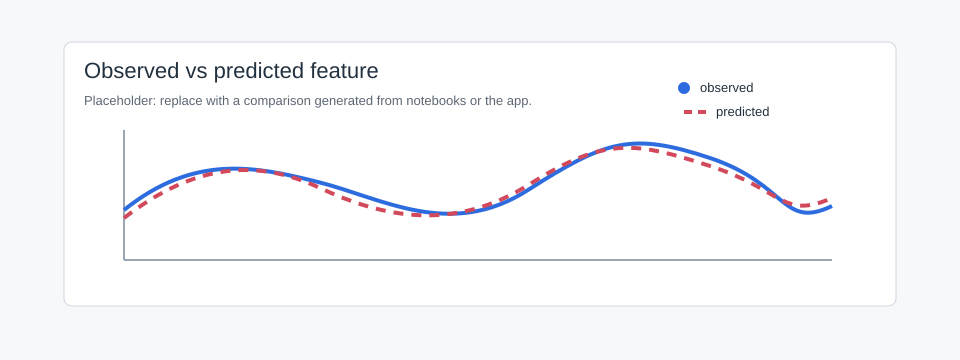

Plotting
========

DNAscape plotting helpers wrap matplotlib for common replication-genomics
views.

Helpers
-------

``plotf``
   One or more profiles.

``mplotf``
   Multi-panel profiles.

``ploth``
   Histograms.

``plotw``
   Whisker or violin summaries.

``plothm``
   Heatmaps.

Profile:

.. code-block:: python

   from dnascape import plotf

   fig, ax = plotf(
       timing,
       timing_pred,
       labels=["Observed", "Predicted"],
       x_array=x_kb,
       xtitle="Genomic position (kb)",
       ytitle="Replication timing (min)",
       invyQ=True,
   )

Heatmap:

.. code-block:: python

   from dnascape import plothm

   fig, ax = plothm(
       replicated_fraction_xt,
       xtitle="S-phase time (min)",
       ytitle="Genomic position (kb)",
   )

   Placeholder for an observed-versus-predicted plot.

App Page
--------

Plotting previews and exports profile figures.

Inputs
   CSV, TSV, TXT, or gzipped numeric tables.

Controls
   Type, chromosome, region, smoothing, labels, axis limits, legend, color,
   log/inverted y-axis, size.

Outputs
   Preview, PNG/PDF/SVG downloads, cached figure.

Python
   ``plotf``, ``mplotf``, ``ploth``, ``plotw``, ``plothm``.

Placeholders
------------

Replace the current placeholders with app screenshots and notebook-generated
plots when final figures are available.
